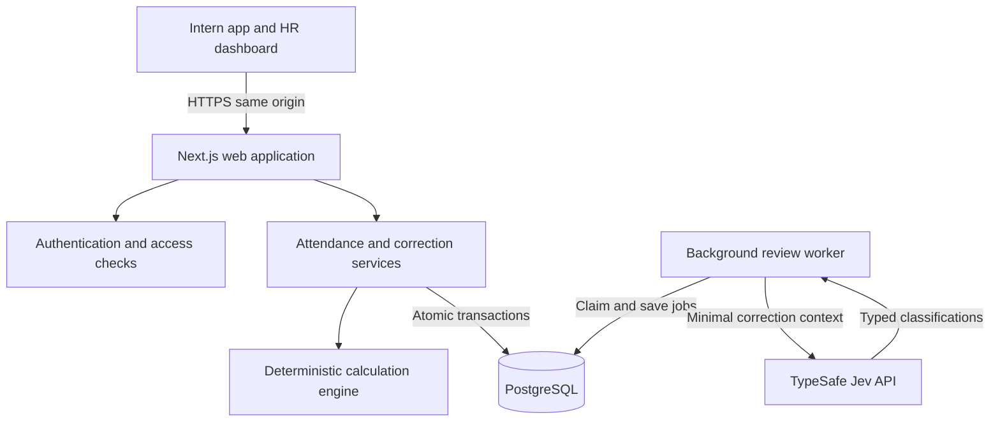

# Top Realty Intern Attendance System

## Technical design

**Version 1.0 | 19 October 2026**

Design baseline for implementation using **Next.js and TypeScript**.

This document translates the approved intern flow, HR flow, logical ERD, and master document into an application design. It specifies components, data ownership, scan processing, calculations, corrections, API contracts, and release checks. It is a design specification; the application has not been implemented or performance tested.

### Design decisions

| Area | Decision |
| --- | --- |
| Application | One Next.js application with intern and HR routes; server logic organized into domain modules. |
| Database | PostgreSQL with Prisma, plus SQL migrations for constraints and locking that need direct database support. |
| Accounts | Better Auth email/password authentication, database sessions, and HR-managed onboarding. |
| Attendance | Separate office Time In and Time Out QR codes; server validation and atomic database saves. |
| Calculation | Deterministic attendance policies and integer credited minutes. |
| AI assistance | TypeSafe Jev classifies correction context asynchronously; HR makes every correction decision. |
| Deployment | Web process, background worker, and private PostgreSQL database. |

### Status of choices

Next.js and TypeScript are user requirements. PostgreSQL, Prisma, Better Auth, the QR library, and the deployment layout are recommended technical choices for this version. Package versions will be verified together and pinned in the implementation lockfile. HR policy values and office settings remain configurable and must be supplied before a live pilot.

The earlier phrase "two-tier" describes two decision stages: deterministic validation followed by advisory review. The deployment contains a browser, application server, and database, with a separate worker for Jev. It should be described as a web application with three logical layers, rather than a strict two-tier deployment.

### Related documents

- Approved product document: `Top_Realty_Intern_Attendance_Master_Document_v1_0.pdf`.
- [Intern flow, HR flow, and logical ERD in FigJam](https://www.figma.com/board/iPPzL7Rs0RnnaU3wTmF4l9).
- [Attendance ERD section](https://www.figma.com/board/iPPzL7Rs0RnnaU3wTmF4l9?node-id=9-1049).

<!-- pagebreak -->

## 1. System architecture

<!-- architecture -->



### Component responsibilities

| Component | Responsibility |
| --- | --- |
| Intern browser | Keep the authenticated session; scan a QR; request location; send a scan attempt; show the saved result and personal hours. |
| HR browser | Manage interns and settings; inspect filtered attendance; review corrections; request exports. |
| Next.js server | Authenticate every protected request; enforce ownership and role checks; validate QR and location evidence; execute transactions. |
| Calculation module | Convert effective sessions and a pinned policy into reproducible credited minutes. No AI calls or database writes. |
| PostgreSQL | Preserve raw scans, effective sessions, corrections, receipts, job state, and audit history. Enforce uniqueness and concurrency rules. |
| Review worker | Classify correction context through Jev, handle retries, and store advisory assessments. It cannot change attendance. |

Use the Next.js Node runtime for database, QR verification, and authentication routes. Route handlers expose versioned APIs. Keep one deployable application and a worker from the same repository; microservices and Redis are unnecessary for the initial pilot. [S1-S3]

The attendance request never waits for Jev. A worker outage affects review assistance; it does not prevent valid attendance saves or deterministic hour calculations.

<!-- pagebreak -->

## 2. Application structure and account access

### Proposed repository layout

```text
src/app/(intern)/       dashboard, scan, history, corrections
src/app/(hr)/hr/        overview, interns, attendance, reviews, reports
src/app/api/v1/         application route handlers
src/app/api/auth/       Better Auth route adapter
src/modules/           accounts, offices, attendance, corrections, reports
src/domain/            calculation, policy schemas, state transitions
src/lib/               database, auth, QR signing, validation, telemetry
src/worker/            review jobs, Jev adapter, lease handling
prisma/                schema and reviewed SQL migrations
tests/                 unit, PostgreSQL integration, browser scenarios
```

Routes translate validated requests into service calls. Business rules live in modules, rather than being duplicated across pages, route handlers, and the worker. Shared TypeScript DTOs still need runtime validation at every trust boundary; use a schema library such as Zod.

### Identity and authorization

Better Auth manages passwords and opaque database sessions. Map its user model to the logical User Account, explicitly configure UUID identifiers, and add the application role and status fields. Its credential account, session, and verification tables are infrastructure tables, separate from Attendance Session. Use secure, HttpOnly cookies in production and the provider's supported server session verification. [S3-S6]

Public signup is disabled. A trusted bootstrap creates the first HR user. Only the application onboarding service may provision INTERN accounts. Configure custom HR/INTERN access rules; block raw provider admin HTTP routes so callers cannot bypass application validation and audit. Disable unused impersonation, hard-delete, and role-promotion operations. App routes do not accept a role from an intern request.

Each protected service checks the current account status, role, ownership, and active internship. A cookie-presence check or navigation redirect is not authorization. Disable session-cookie caching for this design and reload the current role/status server-side. Revoking sessions and disabling the account prevents subsequent protected actions; the transaction rechecks eligibility before a scan is saved.

### Account provisioning

Normalize email and create or resume a PENDING account idempotently. Create the internship, required minutes, department, office assignment, and activation audit record before making the account ACTIVE. A failure leaves the account unable to scan. Send a password setup link through a configured mail provider after activation; retry delivery separately. Do not assume the authentication library and application provisioning are one atomic transaction. No credentials are emailed in plain text.

<!-- pagebreak -->

## 3. Data model and technical additions

The approved ERD has 13 business entities. Keep these concepts: User Account, Department, Office, Internship, Attendance Policy Version, QR Checkpoint, Attendance Session, Attendance Scan, Correction Request, HR Review, Correction Comment, Attendance Revision, and Jev Assessment. The following physical additions support reliable operation; they are proposed extensions to the logical ERD.

| Added table | Important fields and purpose |
| --- | --- |
| scan_intent | id, actorId, internshipId, checkpointId, actionSnapshot, credentialVersion/expiry, expectedAttendanceVersion, expectedSessionId/version, issuedAtUtc, expiresAtUtc, consumedReceiptId. Binds one attempt to an account and attendance state. |
| scan_receipt | id, actorId, requestKey, payloadHash, receivedAtUtc, httpStatus, decisionCode, resultSnapshot. Stores the final outcome for exact replay after a lost response. |
| review_job | id, correctionRequestId, inputFingerprint, modelVersion, criteriaVersion, state, attempts, nextRunAtUtc, leaseToken, leaseExpiresAtUtc, lastErrorCode. Durable queue and retry state. |
| audit_event | id, actorId or system actor, action, resourceType/id, redacted before/after values, occurredAtUtc, correlationId. Records administrative actions and changes. |

### Changes to existing fields

- Internship adds `attendanceVersion`, incremented whenever its effective attendance changes. Both IN and OUT intents bind to this version so delayed requests cannot operate on a later attendance state.
- QR Checkpoint adds `credentialVersion`; its office and action become immutable after use. Rotate or revoke credentials by changing the version, or replace the checkpoint.
- Office adds `configVersion`. A scan preserves the evaluated geofence settings and result so later setting changes do not rewrite history.
- Attendance Scan adds `receiptId` and `actionSnapshot`. Move idempotency ownership from the conceptual scan `requestKey` to `scan_receipt`; early failures need not invent an accepted scan.
- Attendance Session preserves `timezoneSnapshot`, `departmentIdSnapshot`, and its policy version. Its existing `version` protects corrections against concurrent changes. Historical department filters use the snapshot; current staff lists use the active assignment.
- Correction Request adds `requestVersion`, `payloadHash`, and optional `previousRequestId`. Add SUPERSEDED to its status vocabulary. HR Review adds unique `operationKey` and a payload hash for decision retries.
- Jev Assessment adds the request version it evaluated and a SUPERSEDED result state. Preserve model, criteria, input fingerprint, and typed result together.

Use UUID identifiers, UTC `timestamptz`, an explicit office-local attendance `date`, integer target/credited minutes, and versioned JSONB schemas. Add application timestamps consistently. Retain original raw evidence separately from effective values changed by HR. Auth tables and the four operational tables do not replace business entities.

<!-- pagebreak -->

## 4. Database integrity and concurrency

### Required constraints

| Invariant | Enforcement |
| --- | --- |
| One active internship per intern | Partial unique index on internUserId for ACTIVE assignments. |
| One unclosed work interval | Partial unique index on internshipId where time-in exists, time-out is null, and status is OPEN or REVIEW. |
| Valid completed interval | CHECK: COMPLETE requires both times, and time-out must be later than time-in whenever both exist. |
| No overlapping work intervals | PostgreSQL exclusion constraint using btree_gist on internshipId and the half-open time range, for non-VOID bounded sessions. Adjacent intervals may touch. |
| One final result per scan key | Unique (actorId, requestKey) on scan_receipt; compare canonical payload hashes on reuse. |
| One accepted action per session | Partial unique (sessionId, actionSnapshot) on ACCEPTED scans with a linked session. |
| One application of an approval | Unique Attendance Revision.reviewId; locked request transition and HR operation key. |
| One review of the current proposal | Partial uniqueness for pending/needs-info requests by session; separate uniqueness by internship/date for missing-day requests. |
| Unique AI work identity | Unique correction/request-version/input-fingerprint/model/criteria combination for jobs and assessments. |

Express partial indexes, range exclusion, and extension setup in reviewed SQL migrations where Prisma cannot represent them directly. Database CHECK constraints cannot validate arbitrary cross-table ownership. Services verify office, internship, checkpoint, and session relationships inside the mutation transaction; use composite foreign keys where practical. [S7-S9]

### Locking protocol

Every attendance mutation locks the Internship parent row first, even if no session exists. Then lock the relevant session, request, and review rows in a consistent order. Recheck account eligibility, versions, interval validity, and the current state after acquiring locks. Never hold these locks while calling Jev or sending email.

Receipt reservation happens before attendance locks. A competing request with the same receipt key waits for the unique insertion to resolve, then replays the committed result. A rollback frees the reservation. Different keys for the same intern serialize at the Internship row. Retry a transient deadlock or serialization failure only as a bounded transaction retry using the same input and receipt key.

Index session history by internship/date/status; HR requests by status/submittedAt/id; scans by internship/receivedAt; ready jobs by state/nextRunAt; and audit history by resource/time. Use RESTRICT for attendance parent deletion; disable accounts instead. DB roles must prevent application code from casually editing raw scans, reviews, or revisions after creation.

<!-- pagebreak -->

## 5. QR credentials and location evidence

### Office QR design

The baseline supports two printed office QR codes: TIME_IN and TIME_OUT. Each contains an application-specific signed token, without intern identity or department. Use a standard JWS library with an explicit HS256 allowlist and a separate signing keyring. Validate `iss`, `aud`, `kid`, `nbf`, `exp`, checkpoint id, action, and credential version. Never accept an algorithm selected freely by the token or retrieve keys from a token-supplied URL.

The credential must expire; its lifetime is chosen when HR issues it. Set intent expiry to the earlier of credential expiry and the intent lifetime, and recheck both when saving a new scan. Checkpoint deactivation or a credentialVersion increment revokes old copies. Protect signing keys in the server secret store. A printed credential is reusable until expiry/revocation and can be photographed. A rotating office display can be added later, but is not assumed hardware for this version.

### Location rule

The app requests a new high-accuracy position after receiving a short-lived scan intent. Use `maximumAge: 0`; validate latitude/longitude ranges and finite, nonnegative accuracy. Engineering defaults are a 60-second intent and a reported location sample no older than 30 seconds, with up to 5 seconds of future clock skew. These are configurable implementation values, separate from HR work-hour rules.

The server computes distance `d` from the configured office center, using a consistent geodesic/Haversine implementation. Let `R` be the office radius, `a` the reported accuracy radius, and `Amax` the permitted accuracy limit:

```text
Accept location:    a <= Amax AND d + a <= R
Clearly outside:   d - a > R
Otherwise:         uncertain; request a fresh sample or correction
```

Store the evidence, evaluated rule version, distance, and decision with the scan. The client timestamp is a freshness signal, not a trusted attendance time. The intent expiry bounds when a new result can be submitted; an existing receipt can still be retrieved afterwards.

### Practical assurance

Browser location requires permission and may be inaccurate indoors. The reported accuracy is an estimate; the API does not guarantee actual location. QR plus browser location reduces casual remote entry but cannot prove physical presence or defeat a determined spoofing client. [S10] HR must calibrate radius and accuracy at the real entrance. If stronger assurance is required, evaluate a supervised kiosk or dedicated reader as a separate scope decision. Never silently allow a scan when location is unavailable.

<!-- pagebreak -->

## 6. Atomic scan protocol

1. The signed-in intern opens the scanner. Decode the office QR once and pause camera callbacks. Request a scan intent with the QR token.
2. The server authenticates, resolves the active internship, validates the QR, and reads the current attendanceVersion under the Internship lock. IN requires no unclosed session; OUT requires an eligible unclosed session. Save a random, expiring intent bound to that exact state.
3. The browser requests a fresh location, creates a requestKey once, and sends the intent id plus location evidence. It sends no trusted intern id, department, action, attendance date, or attendance timestamp.
4. The server authenticates and validates the DTO. Look up an existing receipt by actor and key first. If the canonical payload hash matches, replay its saved response. A different payload with the same key receives KEY_REUSED (409).
5. For a new key, begin a transaction and reserve the receipt. Lock the Internship, then session as needed. Read database time after the lock for the new attempt's receivedAtUtc; time spent waiting for the lock cannot backdate attendance. Verify the intent owner, expiry, unused state, checkpoint version, account eligibility, expected attendanceVersion, and expected session/version.
6. Validate location and attendance rules. Save the accepted scan and session change, increment attendanceVersion and session version, consume the intent, append audit data, and finish the receipt in the same transaction. If a business rule rejects an otherwise resolved attempt, save a terminal rejected outcome and consume that intent; retry requires a new intent and key.
7. Commit, then return the exact saved outcome. The browser displays success only after receiving that committed result.

Malformed, unauthenticated, or unknown-checkpoint requests do not require a fake Attendance Scan row. Log a redacted security event as appropriate. A database outage rolls back the entire transaction and does not produce a saved confirmation. Intent-expired and stale-state responses remain terminal for that key.

### Lost response and repeated scans

After a timeout, keep the scanner paused. Query the receipt using the same account and requestKey, or repeat the identical body and key. Receipt lookup precedes current intent expiry/state checks, so a committed success is still recoverable. The unique reservation resolves a race between lookup and retry.

A new location sample changes the payload and requires a new attempt; do not mutate the body while reusing its key. If there is no committed receipt and the intent expired, start a new attempt. Never backdate the replacement to the earlier browser time.

Two distinct IN requests from the same attendance state cannot both succeed. A delayed OUT cannot close a later session, and a delayed IN cannot reopen attendance after another session has completed: both bind to attendanceVersion. Actions are explicit; scanning never toggles IN into OUT automatically. Replays return the original result, with current totals refreshed separately if necessary.

<!-- pagebreak -->

## 7. Attendance state and credited minutes

| State | Meaning and credit |
| --- | --- |
| OPEN | A saved time-in without time-out. No completed interval credit. |
| COMPLETE | A valid, closed interval eligible for deterministic policy calculation. |
| REVIEW | Evidence exists but the interval needs HR attention. Withhold this interval's credit until resolved. |
| VOID | An excluded interval retained for history. Reserved for a future audited invalidation workflow; normal version 1 actions do not enter this state. |

A normal IN creates OPEN. A valid OUT closes that exact interval as COMPLETE. An out-of-policy departure, such as an unsupported overnight span, may preserve the actual OUT as REVIEW with zero credit. Missing OUT never invents a departure or a full day. A pending correction does not erase existing valid COMPLETE credit; only an approved revision changes effective values.

### Policy selection

Store immutable policy versions with validated schedule, break, cap, and rounding rules. The first session for an internship/attendanceDate pins the day policy; further sessions and calculation use that policy. Preserve the office timezone in each session. A policy edit applies to future dates by default. Historical recalculation is a distinct, audited HR operation outside the first release.

No production default assumes eight hours, a lunch deduction, or a local timezone. An office without a configured policy/timezone cannot accept attendance. Version 1 supports same-office-local-date intervals; cross-midnight attendance is flagged for HR and excluded until an explicit policy enhancement is approved. A correction must use timestamps consistent with its office-local date and supported policy.

### Deterministic calculation order

1. Collect eligible COMPLETE intervals for the internship and local date; validate ordering and non-overlap.
2. Intersect intervals with allowed schedule windows, then sum seconds. Gaps between recorded sessions are already excluded.
3. Apply any additional approved break deduction once per day. For a required break in a defined window: additional deduction = max(0, required break seconds - qualifying recorded gap seconds). Bound gaps to that policy window and threshold.
4. Clamp negative duration to zero, apply the configured daily cap, and perform day-level rounding once. Specify floor, ceiling, or nearest half-up plus unit in the policy schema. Require a whole-minute cap aligned with the rounding unit, so rounding cannot exceed the cap. Avoid per-scan rounding and double deductions.
5. Produce integer credited minutes. Total = sum of daily credited minutes; remaining = max(required minutes - total, 0). Format hh:mm directly from minutes; decimal hours are presentation only.

Test fixture, not Top Realty policy: 09:00-12:00 and 13:00-18:00 yield 480 recorded minutes. With a qualifying 60-minute gap and a 60-minute required break, the additional deduction is zero. A target of 600 minutes then has 120 minutes remaining.

<!-- pagebreak -->

## 8. Correction requests and HR decisions

An intern submits a reason and proposed changed times. `changes.timeInUtc` and `changes.timeOutUtc` are optional when correcting an existing session: omission means unchanged; null is rejected. A missing-day request has no session and requires both times. Proposed values must form a supported, same-local-date interval. The server supplies ownership and checks the internship/date range.

The client supplies a stable request UUID for creation. Repeating it with the same immutable proposal returns the original request; changed payloads conflict. Save its payload hash, baseSessionVersion, requestVersion, and an initial review job atomically.

### Request lifecycle

```text
PENDING -> APPROVED
PENDING -> REJECTED
PENDING -> NEEDS_INFO -> APPROVED or REJECTED
PENDING or NEEDS_INFO -> SUPERSEDED by a replacement proposal
```

Proposed structured times are immutable. While a request is PENDING or NEEDS_INFO, HR and interns append comments for clarification; each comment increments requestVersion and schedules a fresh advisory assessment. Changing the proposed times creates a replacement request and atomically marks the prior pending/needs-info request SUPERSEDED. Preserve prior comments, assessments, and decisions. Finalized requests are read-only.

### Decision transaction

HR sends a decision, note, operationKey, expectedRequestVersion, and expectedSessionVersion when a session exists. For a missing-day approval, also require the attendanceVersion shown in HR's current preview. The server verifies the HR role, locks Internship then session and request, and rechecks versions. A stale view gets a 409 conflict and must refresh. Reject and needs-info append a review without modifying effective attendance.

Approval validates dates, policy, overlap, and current state. Within one transaction it creates or updates the effective session, records the HR Review and Attendance Revision with before/after values, finalizes the request, increments versions, and writes the audit event. A missing-day approval creates its session in that same transaction. Existing scans remain unchanged.

One operationKey may represent only one canonical decision payload. Repeating it returns the saved review result; a changed payload conflicts. A finalized request cannot be applied twice. A concurrent new scan or HR correction invalidates the request's base session version, requiring HR to refresh or the intern to submit an updated proposal.

HR can decide when Jev is queued, failed, or unavailable. The panel displays which request version the assessment covers. An assessment for superseded context is historical information and is never presented as current advice. The decision form shows current effective times, original scan evidence, proposed times, comments, and the recalculated effect before approval.

<!-- pagebreak -->

## 9. Jev integration and durable work

Use the stable, pinned `jev-1.13.0` model as the initial evaluation candidate, rather than a moving alias or preview. Call the official `POST https://api.typesafe.ai/v1/systemone` endpoint through a server-side adapter. Confirm the request schema against the official API during implementation. [S12-S14]

### Bounded assessment contract

| Criterion | Typed output | Use |
| --- | --- | --- |
| Explanation category | Choice: missed_clock_in, missed_clock_out, wrong_action, technical_issue, other | Sort and label the HR review queue. |
| Required explanation present | Noul, a value from 0 to 1 | Advisory completeness signal; never proof that the claimed event happened. |

The input contains the correction reason, relevant comments, and deterministic facts such as whether the session has a recorded time-out. Do not send names, emails, precise GPS, photos, passwords, QR tokens, or full attendance histories. Free text can still contain personal information: apply minimization and redaction, and obtain the company's approval for the service's processing terms before live use.

Validate response types, expected option keys, finite numeric ranges, and probability distributions where applicable. Choice confidence is a model output; it is not a measured probability that an intern is truthful. Noul does not supply a separate confidence field. Do not invent a confidence threshold. Evaluate labeled, minimized examples with HR and version any display threshold chosen later. Unreliable or invalid results become unavailable advice.

### Worker protocol

Creating a correction or adding relevant context writes a review_job in the same database transaction. The worker claims ready rows in a short `FOR UPDATE SKIP LOCKED` transaction, sets RUNNING plus a unique leaseToken, then commits before the HTTP request. PostgreSQL documents SKIP LOCKED as suitable for queue-like consumers. [S9]

Proposed engineering defaults: 5-second HTTP timeout, 60-second lease, and up to three attempts with exponential backoff, jitter, and Retry-After support. Reclaim expired leases. The external request is at-least-once: a crash after Jev responds may cause a duplicate call and charge.

Completion must match the leaseToken, input fingerprint, requestVersion, model, and criteria version. If context changed or the request finalized, retain a SUPERSEDED assessment and do not overwrite current advice. A stale worker must not update another worker's job. Store typed output and a minimized, access-controlled input snapshot. Failed jobs show a manual-review state and may be retried explicitly.

Give the worker only the database privileges needed for context reads, jobs, and assessments. It has no attendance/revision write access. All time arithmetic, geofence validation, and approval rules stay deterministic.

<!-- pagebreak -->

## 10. API catalog and access boundaries

All application endpoints use `/api/v1`. Authentication uses the provider adapter under `/api/auth`. Same-origin cookie authentication, provider origin/CSRF protection, and explicit origin/CSRF validation for custom mutating routes are required. Reject unexpected body fields and oversized payloads. Never accept client-supplied ownership as authority.

| Method and path | Actor and purpose |
| --- | --- |
| GET /me | Own account, active internship, capabilities. |
| GET /me/attendance | Own sessions; bounded date filters and cursor pagination. |
| GET /me/summary | Own credited and remaining minutes, calculation version/as-of. |
| POST /scan-intents | Intern; verify QR and bind current attendance state. |
| POST /attendance/scans | Intern; commit the scan protocol. |
| GET /attendance/receipts/{requestKey} | Owner only; recover a terminal scan response. |
| POST /corrections | Intern; create an immutable proposal or its replacement. |
| GET /corrections/{id} | Owner or HR; detail and authorized evidence. |
| POST /corrections/{id}/comments | Owner or HR; append context, increment version. |
| GET /hr/attendance | HR; intern, department, date, state filters. |
| GET /hr/corrections | HR; queue filtered by status, date, category. |
| POST /hr/corrections/{id}/reviews | HR; version-checked approve, reject, or needs-info. |
| POST /hr/interns | HR; resumable account/internship provisioning. |
| PATCH /hr/interns/{id} | HR; allowed profile/assignment fields with expected version. |
| POST /hr/offices/{id}/policies | HR; publish a future policy version. |
| PATCH /hr/offices/{id} | HR; versioned location/configuration update. |
| POST /hr/checkpoints/{id}/rotate | HR; revoke and reissue a QR credential. |
| GET /hr/reports/dtr | HR; preview or CSV for bounded filters. |

Detail/list responses expose only the fields needed by that actor. Interns cannot enumerate other interns, query their receipt keys, or retrieve HR-only audit/context data. The worker is not exposed as a public API. Every HR administrative mutation records an audit event and uses an operation key or expected version where retries could duplicate work.

Use ISO 8601 UTC for instants, explicit YYYY-MM-DD for office dates, and integer minutes for durations. APIs return `Cache-Control: private, no-store`; no shared CDN or service-worker caching of private attendance, QR tokens, or account responses. Use cursor pagination with a stable id tie-breaker and bounded filter ranges.

<!-- pagebreak -->

## 11. Scan request and response contracts

### New scan request

```json
{
  "intentId": "<server-issued UUID>",
  "requestKey": "<stable UUID for this payload>",
  "location": {
    "latitude": 14.00001,
    "longitude": 121.00001,
    "accuracyMeters": 12,
    "capturedAtUtc": "2026-10-19T01:00:02Z"
  }
}
```

Coordinates and timestamps above are illustrative and are not the Top Realty office configuration. Canonical hashing includes the parsed intent id, request key, and exact validated location DTO in a stable serialization.

### Saved response

```json
{
  "receiptId": "<UUID>",
  "decision": "ACCEPTED",
  "action": "TIME_IN",
  "sessionId": "<UUID>",
  "receivedAtUtc": "2026-10-19T01:00:03Z",
  "sessionVersion": 1,
  "attendanceVersion": 7
}
```

Return 201 for a new accepted save and replay the same status/body for an identical retry. A separate header may identify replay without changing the receipt body. A saved rejection uses its terminal status and error code. A receipt GET returns 200 with the original `httpStatus` and `result` envelope; 404 means no committed receipt is visible at that moment, so the client may retry the same original POST safely.

### Errors and feedback

Use `{error: {code, message, retryable, correlationId}}` for errors. Return 401 for an expired login, 403 for prohibited access or an inactive internship, 409 for stale state/key reuse/consumed intent, 422 for invalid or uncertain location and invalid intervals, 429 for rate limits, and 503 for transient service/database failure. Unknown, revoked, or malformed QR credentials are rejected at intent creation without revealing account data.

The scanner maps these codes to clear actions: sign in, move near the entrance, allow permission, retry a fresh position, refresh attendance, or request a correction. "Checking..." and "Could not confirm save" must never look like a saved punch. Display the server timestamp and action on success; refresh the summary separately.

<!-- pagebreak -->

## 12. Browser behavior, HR reporting, and privacy

### Intern experience

Use a mobile-responsive web app with a rear-camera scanner, initially `@zxing/browser`. Load camera code only on the scanner route and stop the decode stream after the first successful token read. Release camera resources on exit. Camera/location access requires HTTPS and browser permission; onboarding may need one-time permission taps even though daily attendance has no form or submit button. [S10-S11]

The intern opens the signed-in app and scans the intended IN or OUT code. Show account identity before scanning, and action/server time after saving. Disable automatic repeated scanning while a result is unresolved. If the account session expires, require login again. Optional home-screen installation does not make attendance offline-capable; failed scans are not silently queued for backdated credit.

### DTR and filters

The dashboard and export use the same calculation module and policy versions. Filter by intern, department, office-local date range, and record state. Show raw elapsed time only when clearly labeled; use credited minutes for completion progress. Pending requests and review intervals remain visible, with existing valid credit preserved.

The first implementation exports CSV with one daily row per internship/date, session detail, credited minutes, totals, required/remaining minutes, pending/review markers, timezone, policy version, and generation time. Multiple intervals must remain distinguishable; do not flatten them into a false continuous work span. Exact school/company DTR formatting and a printable PDF template are pending HR confirmation.

Generate each report from a short repeatable-read database snapshot. Materialize bounded rows, complete the transaction, then stream the CSV; do not hold a snapshot open during a slow download. Proposed initial export cap: 10,000 daily rows, with a prompt to narrow filters above that. Quote CSV correctly and neutralize formula-leading user text. Log filters, as-of time, and a content hash; a hash alone is not a signed archival record.

### Privacy and retention

Collect location only for a submitted scan, not continuous tracking. Restrict raw coordinates to authorized HR evidence views. Exclude coordinates, correction text, passwords, cookies, QR credentials, and Jev keys from routine logs and analytics. Define separate retention periods for raw location, attendance, corrections, model context, audits, and backups with HR before launch.

The first release does not add biometric recognition. Whether the previous daily photo requirement can be replaced by this process is a company decision still to confirm. Account disablement preserves required records; deletion or anonymization follows an approved retention process, rather than a browser button that breaks the audit trail.

<!-- pagebreak -->

## 13. Deployment, security, and operations

### Deployment topology

Run a Next.js web container and a persistent Node worker from the same versioned repository, connected to a managed PostgreSQL database through a private network and TLS. Place HTTPS termination and request-size/rate limits in the platform or reverse proxy. Select a provider after confirming database extensions, background-process support, regional hosting, backups, and budget. Next.js supports self-hosting; provider-specific availability has not been contracted. [S2]

Do not depend on fire-and-forget code after a serverless HTTP response to finish Jev jobs. The database queue survives web restarts. The worker can be scaled independently; SKIP LOCKED and leases coordinate multiple instances. Keep connection pools bounded across all processes.

### Secret and access boundaries

- Web: authentication secret, database credentials, QR signing keyring, mail-provider secret. Worker: restricted database credentials and Jev key. Never expose these in browser environment variables.
- Separate development, staging, and production secrets and databases. Use synthetic data in staging, with separate QR issuers and API audiences.
- Keep provider CSRF/origin checks enabled. Use secure cookies, rate limits on authentication/scanning/reviews, a camera-compatible Content Security Policy, and dependency/security update checks.
- Restrict raw SQL to reviewed, parameterized service operations. Application roles do not receive migration privileges. HR evidence access and configuration changes are auditable.

### Observability and recovery

Track scan success/rejection codes, database latency, conflicts, worker queue age, lease recovery, Jev errors, and export failures using correlation ids. A liveness check confirms the process is running; readiness checks required configuration and database access. Alerts should identify sustained scan failures or growing review backlog without exposing evidence in logs.

Proposed pilot recovery targets are RPO <= 24 hours and RTO <= 4 hours, subject to the chosen backup service and a restore drill. Enable automated backups and point-in-time recovery where the selected plan supports them; verify retention and recovery rather than assuming these features. Treat a restored database as a possible loss of recent receipts and records, requiring HR reconciliation.

Use reviewed expand/contract migrations, an isolated staging migration check, and a pre-release backup. Roll back application versions only while schema compatibility permits; do not auto-run destructive down migrations. Preserve the queue and receipts across releases. Rotate compromised QR credentials and auth sessions through documented operations.

<!-- pagebreak -->

## 14. Verification and acceptance criteria

| Scenario | Required observable result |
| --- | --- |
| Concurrent IN with different keys | Exactly one accepted state transition; other intent becomes stale. One unclosed session. |
| Same key, same payload, lost response | Original receipt, action, and timestamp replay; no extra scan or credit. |
| Same key, changed location/body | 409; original saved result stays unchanged. |
| Delayed IN/OUT after other activity | Expected attendanceVersion/session mismatch; no later session changed. |
| Transaction fails before commit | No success, partial session, consumed intent, or terminal receipt remains. |
| Poor accuracy, outside office, no permission | Clear failure/retry path; no accepted punch. |
| Expired login or another intern's id | No cross-user access, receipt disclosure, or mutation. |
| Missing OUT and multi-session breaks | No invented departure; no full-day credit or double break deduction. |
| Two HR approvals race | One revision applies; stale/finalized request cannot apply twice. |
| Comment arrives during Jev call | Old assessment is superseded; current context is not overwritten. |
| Worker crashes after external response | Lease recovers; repeat call possible; attendance remains unchanged. |
| Report generated during a correction | One consistent snapshot; dashboard/export use identical arithmetic. |

Unit-test the pure calculation engine with policy fixtures: interval unions, schedule clipping, qualifying break gaps, caps, rounding boundaries, targets, and office-date conversion. Test invalid schemas and token verification. Use real PostgreSQL integration tests for constraints, locking, rollback, and concurrent scans; SQLite cannot validate the PostgreSQL concurrency design.

Browser checks cover mobile Chrome and Safari, HTTPS permissions, camera release, duplicate callback bursts, timeout/receipt recovery, session expiry, and role-based routes. Test the actual office entrance on representative phones before tuning location settings. Do not claim camera/browser support based only on a desktop mock.

Evaluate Jev using a versioned HR-labeled, minimized test set. Measure category quality, completeness usefulness, latency, and cost; do not equate model confidence with correctness. A Jev failure must pass the same attendance/correction acceptance tests as normal operation.

Proposed pilot load fixture: 100 interns, five HR users, and 20 simultaneous scan submissions. Target p95 scan API completion below two seconds under that fixture, excluding camera acquisition, location acquisition, and the user's network. This is an engineering target, not a measured result or a claim about Top Realty's staff count. Include a backup restore drill and recovery reconciliation in release evidence.

<!-- pagebreak -->

## 15. Implementation order and release gates

### Incremental delivery

1. **Foundation:** pin compatible dependencies, add database/auth migrations, establish role checks, HR onboarding, and audit events. Demonstrate that interns see only their own data.
2. **Deterministic attendance:** configure office/policy/checkpoints; build intent, receipt, and atomic scan services; prove concurrency and rollback behavior before polishing the scanner.
3. **Intern and HR screens:** connect camera/location, status/history, filters, and summaries. Verify actual phone behavior at the office.
4. **Corrections and DTR:** add immutable proposals, versioned decisions, revisions, calculation preview, and consistent CSV export. Validate policy examples with HR.
5. **Jev assistance:** add the durable worker, minimized context, typed assessments, version fencing, and manual fallback. Evaluate against labeled examples.
6. **Pilot:** deploy staging and production, complete access/backup checks, train a small group, compare recorded DTRs with HR's reference process, and record discrepancies before wider adoption.

### Settings required before a live pilot

| Owner | Required decision or evidence |
| --- | --- |
| HR | Official office coordinates/timezone; measured radius and accuracy tolerance; authorized departments and interns. |
| HR | Schedules, breaks and qualifying gaps, daily caps, rounding, dates, target minutes, and handling of unsupported overnight work. |
| HR | Whether QR/location replaces the current photo requirement; acceptable attendance assurance; correction and evidence review procedure. |
| HR | Required DTR/CSV fields, report template, attendance/evidence/audit retention, and approved Jev data-processing arrangement. |
| Project owner | Hosting region/provider, budget, mail delivery, managed database extensions, backup service, and secret ownership. |
| Implementation team | Passing concurrency/access/calculation tests, office-device trial, migration check, model evaluation, and demonstrated restore. |

These settings do not require redesigning the main intern or HR flow. Normal attendance remains: sign in, scan the appropriate office QR, automatically validate and save, then view the saved result. The only flow clarification is that uncertain location or stale attendance state produces a retry/correction path, never a false success.

### Deferred features

NFC readers, shared kiosks, biometric recognition, field attendance, payroll, offline attendance credit, cross-midnight schedules, historical policy restatement, and a general HR chatbot remain outside version 1. The schema and domain services allow future entry methods without moving validation or hour calculations into the browser or AI model.

<!-- pagebreak -->

## 16. References and design traceability

Official documentation consulted on 19 October 2026. Links support platform behavior; numerical timeouts, load targets, and deployment decisions in this document are project proposals rather than vendor guarantees.

| Ref | Primary source and relevance |
| --- | --- |
| S1 | [Next.js Route Handlers](https://nextjs.org/docs/app/api-reference/file-conventions/route) - application API boundaries. |
| S2 | [Next.js self-hosting](https://nextjs.org/docs/app/guides/self-hosting) - deployment and infrastructure responsibilities. |
| S3 | [Better Auth Next.js integration](https://better-auth.com/docs/integrations/next) - route adapter and server session checks. |
| S4 | [Better Auth email/password](https://better-auth.com/docs/authentication/email-password) and [cookies](https://better-auth.com/docs/concepts/cookies) - signup configuration and session transport. |
| S5 | [Better Auth database](https://better-auth.com/docs/concepts/database) and [Prisma adapter](https://better-auth.com/docs/adapters/prisma) - model mapping and UUID configuration. |
| S6 | [Better Auth admin plugin](https://better-auth.com/docs/plugins/admin) - provisioning and custom permissions. |
| S7 | [Prisma transactions](https://www.prisma.io/docs/orm/fundamentals/transactions) - transactional operations. |
| S8 | [PostgreSQL constraints](https://www.postgresql.org/docs/current/ddl-constraints.html) and [locking](https://www.postgresql.org/docs/current/explicit-locking.html) - data invariants and row locks. |
| S9 | [PostgreSQL SELECT](https://www.postgresql.org/docs/current/sql-select.html) - FOR UPDATE and SKIP LOCKED. |
| S10 | [W3C Geolocation](https://www.w3.org/TR/geolocation/) - permission, position accuracy, and limitations. |
| S11 | [ZXing browser library](https://github.com/zxing-js/browser) - camera scanning and stream controls. |
| S12 | [TypeSafe models](https://docs.typesafe.ai/models) - pinned Jev versions and release status. |
| S13 | [TypeSafe API](https://docs.typesafe.ai/api) - endpoint and typed Choice/Noul outputs. |
| S14 | [Jev 1.13 limitations](https://docs.typesafe.ai/model-jaggedness/jev-1.13) and [confidence](https://docs.typesafe.ai/confidence) - advisory use and evaluation. |

### Traceability to the approved requirements

Automatic identity/department: Sections 2 and 6. Office location validation: Section 5. Automatic time logging without a daily form: Sections 6 and 11. Filterable HR dataset and remaining hours: Sections 7, 10, and 12. Traceable corrections: Section 8. Jev as advisory review: Section 9. Reliability and pilot evidence: Sections 4, 13, and 14.

The business ERD remains the conceptual reference. Section 3 records the physical schema additions explicitly so the implementation can update the technical ERD without silently changing the approved business model.
