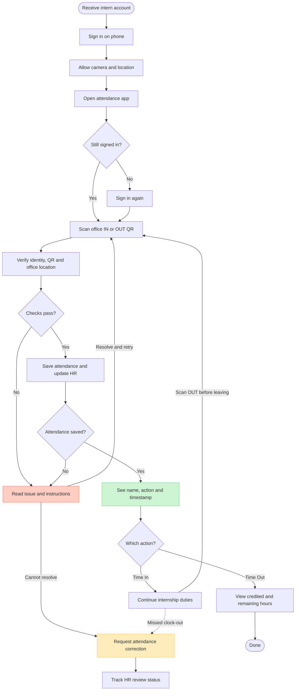
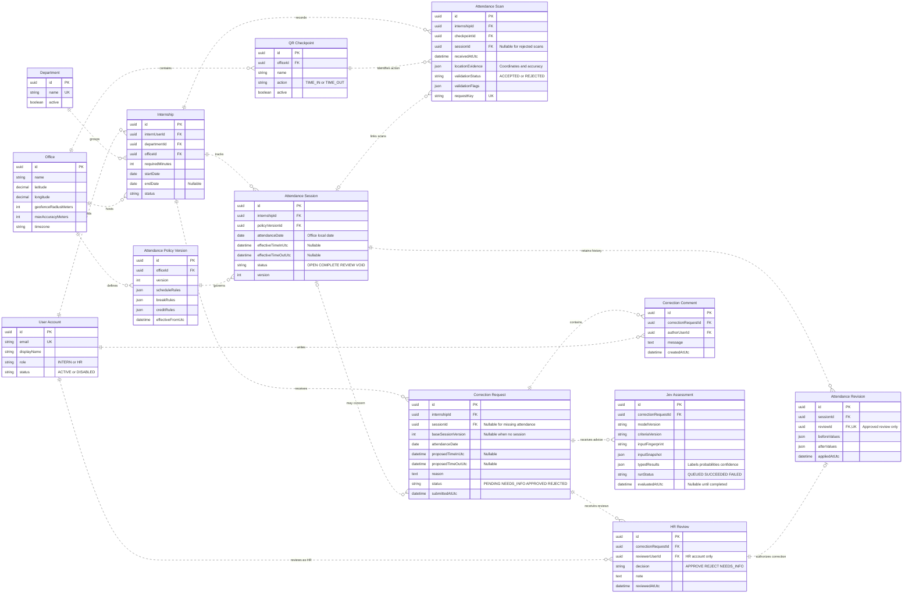

# Top Realty Intern Attendance System

Project definition and solution design

Version 1.0 | 19 October 2026

This internship project will replace routine Google Forms attendance entry with office QR scans linked to each intern account. It will give HR a filterable attendance dataset, consistent DTR calculations, remaining internship hours, and a traceable process for correcting incomplete records.

### The problem

The current process requires interns to submit a photo, select their name and department, and record attendance through Google Forms. HR then checks entries, calculates daily time records and remaining hours, and follows up on missing or disputed submissions. The reported result is repeated revisions, paperwork, and time spent validating cases individually.

### The agreed solution

- Interns use their own phones and a signed-in attendance app at the Top Realty office.
- Separate office QR codes identify Time In and Time Out. Successful scans save attendance automatically.
- The account supplies the intern identity and department. The server supplies the attendance timestamp.
- HR reviews records and correction requests in one panel, with automatic calculations and DTR export.
- Jev classifies correction explanations and supplies review flags. HR approves or rejects corrections.

### Project outcome

The system should reduce repeated data entry and manual arithmetic while keeping uncertain attendance cases visible to HR. Improvement will be measured during a pilot against the current process; no savings percentage or response-time result has been measured yet.

Design baseline The product flow and Jev role are agreed. Company attendance policies, deployment choices, and pilot settings are listed for confirmation in Section 12.

## 2 Scope and access

The first release covers intern attendance at the Top Realty office. A configured office record provides the approved location, local time zone, and associated checkpoints.

| Role | Access and responsibilities |
| --- | --- |
| Intern | Use their own attendance account, scan office QR codes, view their attendance and hours, request corrections, and read or answer HR feedback. |
| HR | Create or update intern profiles and access, assign department and required hours, filter attendance, review exceptions, decide corrections, and generate DTRs. |
| Jev service | Return bounded classifications and review signals for submitted correction context. It has no authority to approve corrections or directly change attendance. |

### Included in the first release

- Account onboarding and role-based access.
- Office QR Time In and Time Out, location checking, and clear saved or failed feedback.
- Raw scan records, effective attendance sessions, and calculation rules.
- Filters by intern, department, date range, and record status.
- Correction requests, clarification comments, HR decisions, and change history.
- Jev review flags, DTR export, and total and remaining hours.

### Later options

NFC cards or tags, a shared office kiosk, biometric recognition, field attendance, payroll processing, continuous location tracking, and a general HR chatbot are outside the first release. NFC remains a possible later entry method using the same attendance rules.

### Daily use and exceptions

Routine attendance has no name selection, department selection, typed hours, or Submit button. Signing in, granting device permissions, and submitting a correction are separate interactions. Whether the current daily photo requirement can be removed must be confirmed with HR before the pilot.

## 3 Intern user flow

HR creates the intern account and internship assignment. At first use, the intern signs in and allows the camera and location permissions. On later visits, a valid session identifies the intern automatically; expired sessions require sign-in again.

Intern attendance overview. The complete editable flowchart is in the linked FigJam board.

### What the scan supplies

The QR identifies the office checkpoint and its action. The authenticated account identifies the intern and active internship. The app requests current location evidence, and the server validates the request and records its own timestamp.

### What the intern sees

Success appears only after the server saves the record. It shows the intern name, Time In or Time Out, and recorded time. A failed scan shows the issue and a retry path. Missing or unresolved attendance goes through a correction request; its proposed times receive no automatic credit.

## 4 HR user flow

HR signs in to a dashboard showing attendance, recorded hours, incomplete records, and correction statuses. From there, HR manages interns, reviews attendance, or generates a DTR.

HR workflow overview. Jev provides classifications and flags; HR makes the attendance decision.

```mermaid
flowchart LR
    hrStart(["HR signs in"])
    dashboard["View attendance dashboard"]
    chooseTask{"Choose task"}
    hrStart --> dashboard --> chooseTask

    subgraph internManagement ["Manage interns"]
        internDirectory["Open intern directory"]
        enterProfile["Enter or update profile"]
        saveProfile["Save profile and access"]
        internDirectory --> enterProfile --> saveProfile
    end

    subgraph attendanceReview ["Review attendance and corrections"]
        filterRecords["Filter intern, department, date"]
        inspectRecords["View records and hours"]
        needsReview{"Flagged record or correction?"}
        aiSummary["View Jev classification and review flags"]
        inspectEvidence["Review record and evidence"]
        hrDecision{"HR decision?"}
        applyCorrection["Save correction and history"]
        recalculateHours["Recalculate credited hours"]
        rejectionReason["Save rejection reason"]
        askClarification["Request clarification"]
        keepPending["Keep record pending"]
        updateStatus["Update intern request status"]

        filterRecords --> inspectRecords --> needsReview
        needsReview -->|"Yes"| aiSummary
        aiSummary --> inspectEvidence --> hrDecision
        hrDecision -->|"Approve correction"| applyCorrection
        applyCorrection --> recalculateHours --> updateStatus
        hrDecision -->|"Reject correction"| rejectionReason
        rejectionReason --> updateStatus
        hrDecision -->|"Need more information"| askClarification
        askClarification --> keepPending --> updateStatus
    end

    subgraph dtrReports ["Generate DTR"]
        reportScope["Choose intern and period"]
        generateDtr["Generate DTR"]
        previewDtr["Review totals and pending items"]
        exportDtr["Export DTR"]
        reportReady(["DTR ready"])
        reportScope --> generateDtr --> previewDtr --> exportDtr --> reportReady
    end

    chooseTask -->|"Manage interns"| internDirectory
    saveProfile --> dashboard
    chooseTask -->|"Review attendance"| filterRecords
    needsReview -->|"No"| dashboard
    updateStatus --> dashboard
    chooseTask -->|"Generate DTR"| reportScope

    style internManagement fill:#C2E5FF,stroke:#3DADFF
    style attendanceReview fill:#F5F5F5,stroke:#B3B3B3
    style dtrReports fill:#C6FAF6,stroke:#5AD8CC
    style hrDecision fill:#FFECBD,stroke:#FFC943
    style keepPending fill:#FFECBD,stroke:#FFC943
    style applyCorrection fill:#CDF4D3,stroke:#66D575
    style rejectionReason fill:#FFCDC2,stroke:#FF7556
```

| HR decision | Result |
| --- | --- |
| Approve | Apply the approved correction, preserve before and after values, and recalculate eligible hours. |
| Reject | Record the reason and update the request status. The proposed correction receives no credit. |
| Need more information | Keep the request pending and ask for clarification through the request comments. |

Filtering narrows the dataset before HR opens a record. DTR preview shows credited totals together with pending items, so unresolved requests remain visible. Interns can track the resulting review status.

## 5 Attendance and calculation rules

- Each account must resolve to one active internship assignment for ordinary scanning. Only an active intern account may record its own attendance.
- The backend verifies the office checkpoint, QR authenticity and validity, account access, location freshness, and permitted geofence and accuracy settings.
- An accepted Time In opens a session. Time Out closes the matching open session. An unmatched or repeated action does not invent a missing time or switch automatically to the other action.
- Repeated requests with the same request key return the existing outcome. A new repeated scan must not create duplicate hours.
- Original scan evidence remains unchanged. An HR-approved correction updates the effective session through a separate revision record.
- Incomplete, rejected, or pending attendance contributes no additional credited duration until it becomes a valid completed session.
- Store timestamps in UTC and determine attendance dates in the configured office time zone. HR must define how overnight work is assigned.
- Apply the relevant policy version for schedules, breaks, caps, and rounding. Historical policy versions must remain available.

### How hours are calculated

Worked duration is the total duration of eligible completed sessions. Credited duration applies the configured break, schedule, cap, and rounding rules to that duration. The implementation must define whether each deduction applies per session or per attendance day so it is never deducted twice.

Total credited minutes = sum of eligible credited attendance minutesRemaining minutes = max(required internship minutes minus total credited minutes, 0)

Illustration only: a 09:00 to 18:00 session spans 540 minutes. If HR confirms a 60-minute unpaid break and no other adjustment, the credited duration is 480 minutes. These are example values, not adopted Top Realty policy. Late arrival, overtime, holidays, and exceptional schedules need explicit HR rules.

## 6 System design and Jev role

The design has two validation stages: exact application rules and advisory model judgments. The software itself has client interfaces, an application service, and a relational data layer, with Jev called by a background review worker. This is more precise than describing the entire system as two software tiers.

Logical responsibilities. A particular framework, hosting provider, database product, and job system have not been selected.

### Jev baseline

Use the pinned model ID jev-1.13.0 as the evaluation baseline. At the documentation check on 19 October 2026, TypeSafe listed it as stable and Jev 1.14 as the preview. Version pinning makes test results traceable when the provider releases updates. [1]

Jev returns typed choices, scores, or probabilities. The HR interface therefore shows fixed classifications and predefined explanations instead of an AI-written narrative. Useful questions include the correction reason category and whether the submitted explanation contains required information. [2]

Jev must not calculate hours, compare exact timestamps, establish physical presence, or authorize attendance changes. TypeSafe documents limitations with arithmetic and date comparisons. Model confidence expresses uncertainty; it does not verify a proposed attendance time. [3][4]

Evaluate anonymized, HR-labeled cases for accuracy, missed flags, unnecessary flags, and latency before enabling the model. Uncertain results and service failures stay available for manual HR review. Scans and DTR calculations continue without a successful Jev call.

## 7 Entity relationship model

The ERD contains 13 entities and 19 relationships. It separates account and office setup, immutable scan evidence, effective attendance sessions, and the records used to review and audit corrections.

Entity groups. Full fields, keys, and relationship cardinalities are available in the editable ERD.

[Complete ERD in FigJam](https://www.figma.com/board/iPPzL7Rs0RnnaU3wTmF4l9?node-id=9-1049)

### Principal relationships

- A user account may hold multiple internship records over time. Each internship belongs to one department and one office.
- An internship has attendance sessions and scan records. Each session uses one policy version. A rejected scan may have no session.
- A correction belongs to an internship and may reference a session. A missing attendance day can be requested before a session exists.
- A correction can have several HR review events, comments, and Jev assessments. Every HR review identifies the reviewing account.
- An approved review can authorize one attendance revision. Revision history preserves the effective values before and after the change.

### DTRs and remaining hours

DTR totals are calculated views of valid attendance and the applicable policy; the ERD does not introduce a second manually editable total. Required internship minutes are stored on the internship. Report file retention and a formal signed DTR archive can be added when HR confirms its export process.

## 8 Core data dictionary

PK marks a primary key, FK a relationship to another entity, and UK a unique value. The editable ERD also shows field types and optional values.

### User Account

The intern or HR identity used for application access. Authentication credentials are managed by the selected authentication mechanism.

- `id` - uuid, PK
- `email` - string, UK
- `displayName` - string
- `role` - string, INTERN or HR
- `status` - string, ACTIVE or DISABLED

### Department

The department assigned to an internship.

- `id` - uuid, PK
- `name` - string, UK
- `active` - boolean

### Office

The attendance site, local time zone, and location validation configuration.

- `id` - uuid, PK
- `name` - string
- `latitude` - decimal
- `longitude` - decimal
- `geofenceRadiusMeters` - int
- `maxAccuracyMeters` - int
- `timezone` - string

### Internship

The intern assignment linking account, department, office, dates, and required duration.

- `id` - uuid, PK
- `internUserId` - uuid, FK
- `departmentId` - uuid, FK
- `officeId` - uuid, FK
- `requiredMinutes` - int
- `startDate` - date
- `endDate` - date, Nullable
- `status` - string

### Attendance Policy Version

An immutable version of the rules used to calculate attendance credit.

- `id` - uuid, PK
- `officeId` - uuid, FK
- `version` - int
- `scheduleRules` - json
- `breakRules` - json
- `creditRules` - json
- `effectiveFromUtc` - datetime

### QR Checkpoint

An office QR checkpoint with an explicit Time In or Time Out action.

- `id` - uuid, PK
- `officeId` - uuid, FK
- `name` - string
- `action` - string, TIME_IN or TIME_OUT
- `active` - boolean

### Attendance Session

The effective work interval used by attendance calculations, including incomplete intervals.

- `id` - uuid, PK
- `internshipId` - uuid, FK
- `policyVersionId` - uuid, FK
- `attendanceDate` - date, Office local date
- `effectiveTimeInUtc` - datetime, Nullable
- `effectiveTimeOutUtc` - datetime, Nullable
- `status` - string, OPEN COMPLETE REVIEW VOID
- `version` - int

### Attendance Scan

The original server-received scan and its validation evidence. Location evidence contains available coordinates, accuracy, capture time, and computed distance.

- `id` - uuid, PK
- `internshipId` - uuid, FK
- `checkpointId` - uuid, FK
- `sessionId` - uuid, FK, Nullable for rejected scans
- `receivedAtUtc` - datetime
- `locationEvidence` - json, Coordinates and accuracy
- `validationStatus` - string, ACCEPTED or REJECTED
- `validationFlags` - json
- `requestKey` - string, UK

## 9 Review records and data integrity

### Correction Request

An intern request describing missing or disputed attendance and proposed times.

- `id` - uuid, PK
- `internshipId` - uuid, FK
- `sessionId` - uuid, FK, Nullable for missing attendance
- `baseSessionVersion` - int, Nullable when no session
- `attendanceDate` - date
- `proposedTimeInUtc` - datetime, Nullable
- `proposedTimeOutUtc` - datetime, Nullable
- `reason` - text
- `status` - string, PENDING NEEDS_INFO APPROVED REJECTED
- `submittedAtUtc` - datetime

### HR Review

An appended HR approval, rejection, or request for clarification, with the actor and reason.

- `id` - uuid, PK
- `correctionRequestId` - uuid, FK
- `reviewerUserId` - uuid, FK, HR account only
- `decision` - string, APPROVE REJECT NEEDS_INFO
- `note` - text
- `reviewedAtUtc` - datetime

### Correction Comment

A clarification or supporting explanation written by the intern or HR on a request.

- `id` - uuid, PK
- `correctionRequestId` - uuid, FK
- `authorUserId` - uuid, FK
- `message` - text
- `createdAtUtc` - datetime

### Attendance Revision

The before and after session values resulting from one approved HR review.

- `id` - uuid, PK
- `sessionId` - uuid, FK
- `reviewId` - uuid, FK, UK, Approved review only
- `beforeValues` - json
- `afterValues` - json
- `appliedAtUtc` - datetime

### Jev Assessment

The model input snapshot and structured output for one evaluation of a correction request.

- `id` - uuid, PK
- `correctionRequestId` - uuid, FK
- `modelVersion` - string
- `criteriaVersion` - string
- `inputFingerprint` - string
- `inputSnapshot` - json
- `typedResults` - json, Labels probabilities confidence
- `runStatus` - string, QUEUED SUCCEEDED FAILED
- `evaluatedAtUtc` - datetime, Nullable until completed

### Constraints that implementation must enforce

- Only HR accounts can create review decisions. Interns can read and comment on their own requests only.
- A scan, session, correction, checkpoint, policy, and internship linked together must refer to the same permitted intern and office.
- A completed session has a valid start and end, with the end later than the start. Sessions must not overlap, and at most one session is open for an internship.
- Approval checks the base session version and writes the review, revision, and session update in one transaction. A finalized request cannot be applied again, and a stale request cannot overwrite a newer correction.
- Department and office changes must preserve historical assignments. Review and scan history is retained when accounts are disabled.
- An assessment is tied to its model version, criteria version, and evaluated input. Changed input requires a new assessment.

## 10 Security reliability and acceptance

Account identity and authorization are verified by the server. Use HTTPS, protected sessions, signed QR payloads, server-side access checks, restricted HR permissions, and a server-side Jev credential. A QR payload contains a checkpoint reference rather than an intern name or other personal details.

Location is collected for a scan, rather than continuously. Browser location permission and accuracy vary, and location evidence cannot guarantee the device's actual position. A copied QR and spoofed location remain possible; the project must not describe the method as biometric identity verification. [5]

The server returns saved confirmation only after a successful write. A network failure must not display success. Use request keys, attendance state checks, and transactions to prevent duplicate credits. Backups and a tested restoration procedure are required before operational use.

| Acceptance case | Expected result |
| --- | --- |
| Normal IN and OUT | Two accepted scans form a completed session and produce policy-based credit. |
| Repeated scan or retry | No duplicate session, action, or credited time is created. |
| Invalid QR or wrong office | No accepted attendance is created; the intern sees the issue. |
| Missing or inaccurate location | The request follows the configured retry or review path, with no false success. |
| Missing clock-out | The day remains incomplete; no invented departure time or full-day credit. |
| Correction approval | Review, before and after values, session update, and recalculation are traceable. |
| Jev unavailable or uncertain | Attendance remains usable and HR can review the case manually. |
| Access and reporting | Interns cannot access another intern's records; exports match eligible filtered totals. |

## 11 Delivery and pilot evaluation

Build the attendance and correction workflow before depending on model predictions. The order below produces useful, reviewable increments without assuming a delivery date or a technology stack.

| Stage | Reviewable outcome |
| --- | --- |
| 1 Confirm operating policies | HR confirms schedule and break rules, target-hour handling, office settings, photo policy, and DTR format. |
| 2 Accounts and access | HR can register interns and the application enforces account ownership and HR privileges. |
| 3 QR attendance | Valid scans save once, location issues have a recovery path, and session states are visible. |
| 4 Hours and corrections | Calculations match agreed examples; HR can review requests and inspect revision history. |
| 5 Jev evaluation | Anonymized cases establish classification accuracy and latency; uncertain results have a manual path. |
| 6 Pilot and DTR export | A limited pilot compares the new records and exports against HR-verified attendance. |

### Measures to collect

| Measure | How to evaluate it |
| --- | --- |
| HR preparation time | Compare time spent preparing the same kind of DTR period before and during the pilot. |
| Attendance completion | Count missing punches, duplicate attempts, rejected scans, and unresolved requests. |
| Calculation agreement | Reconcile system totals with HR-approved examples and investigate every discrepancy. |
| Intern scan experience | Measure time to saved confirmation, retry frequency, and permission problems. |
| Jev usefulness | Compare model flags with HR labels, including false flags and missed clarification needs. |

Capture the baseline and agree targets with HR before the pilot. There are no measured production results at this stage. The existing attendance process should remain available during reconciliation and rollout.

## 12 Policy decisions and references

These settings require HR or project-owner confirmation before implementation or pilot use. They are deliberately configurable rather than fixed to assumed office rules.

| Decision | Confirmation needed |
| --- | --- |
| Attendance credit | Schedules, breaks, overtime, late arrivals, holidays, caps, rounding, and overnight attribution. |
| Location and QR | Office coordinates and time zone, usable geofence and accuracy limits, QR expiry or rotation, and the path for failed location checks. |
| Existing photo requirement | Whether registered accounts and office verification can replace daily photo submission. |
| Hours and assignments | Required minutes per intern, target changes, completion handling, and transfers between departments. |
| Corrections and exports | Required supporting information, authorized reviewers, DTR template, export format, and any signed archive. |
| Operations and technology | Framework, authentication, database, hosting, recovery, retention, access revocation, API availability, and usage budget. |

### Project artifacts

[Top Realty user flows and ERD in FigJam](https://www.figma.com/board/iPPzL7Rs0RnnaU3wTmF4l9)

The intern flow remains scan-only for normal attendance. The HR flow label is now View Jev classification and review flags. The ERD contains 13 entities and 19 relationships. This document records the design baseline; building and validating the application is the next stage.

### Technical references checked 19 October 2026

[1] [TypeSafe model versions](https://docs.typesafe.ai/models)

[2] [TypeSafe structured decision interface](https://docs.typesafe.ai/introduction)

[3] [Jev 1.13 known limitations](https://docs.typesafe.ai/model-jaggedness/jev-1.13)

[4] [TypeSafe confidence interpretation](https://docs.typesafe.ai/confidence)

[5] [W3C Geolocation specification](https://www.w3.org/TR/geolocation/)

## Complete ERD source

