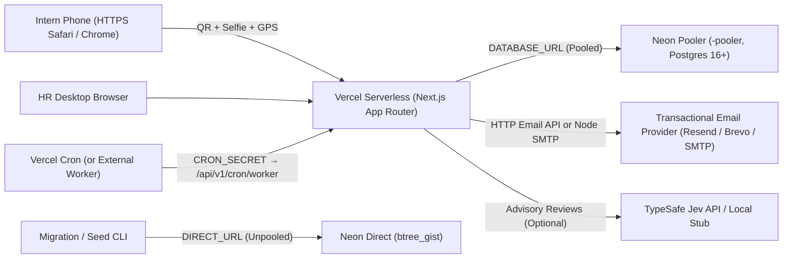

# Vercel Deployment Guide & Readiness Checklist

This document lists **everything currently missing or incompatible** for deploying the **Top Realty Intern Attendance System (`TRCHR`)** to **Vercel** (with **Neon PostgreSQL**), every external service and environment variable required, and the step-by-step go-live checklist.

---

## 1. Architecture on Vercel + Neon



---

## 2. Vercel Readiness Fixes (Implemented in Codebase)

All four runtime/build blockers and security gaps for Vercel have now been implemented in the repository:

- [x] **`postinstall: "prisma generate"`** in [package.json](../package.json) — ensures `@prisma/client` is freshly generated for Vercel's Linux build container even when `node_modules` is cached.
- [x] **Pure Node.js SMTP via `nodemailer`** in [src/lib/mail/index.ts](../src/lib/mail/index.ts) — replaces the Python subprocess so Vercel Serverless Functions send SMTP mail directly over TLS/STARTTLS with zero Python dependency, and fails loudly in production if `SMTP_HOST` is missing.
- [x] **Serverless Worker Cron Route + `vercel.json`** in [src/app/api/v1/cron/worker/route.ts](../src/app/api/v1/cron/worker/route.ts) and [vercel.json](../vercel.json) — `CRON_SECRET`-protected `GET /api/v1/cron/worker` drains ready `ReviewJob` rows and runs `runRetentionCleanup()`, pinned to `cle1` (Cleveland / `us-east-2`, same region as Neon).
- [x] **Prisma Neon Pooling (`DIRECT_URL`)** in [prisma/schema.prisma](../prisma/schema.prisma) and [src/lib/db.ts](../src/lib/db.ts) — separates pooled runtime traffic (`DATABASE_URL`) from unpooled migrations (`DIRECT_URL`) and caches `globalForPrisma.prisma` across warm Lambda invocations.
- [x] **HSTS & Vercel Origin Support** in [next.config.mjs](../next.config.mjs), [src/lib/auth.ts](../src/lib/auth.ts), and [src/lib/http/guard.ts](../src/lib/http/guard.ts) — adds production `Strict-Transport-Security` and trusts `VERCEL_URL` / `VERCEL_PROJECT_PRODUCTION_URL` for Preview and Production deploys.

---

## 3. Remaining Serverless Considerations (Operational)

| # | Item | Where | Notes for Production |
|---|---|---|---|
| **1** | **In-memory rate limiting** | [src/lib/http/rate-limit.ts](../src/lib/http/rate-limit.ts) | Serverless Lambdas do not share RAM across instances or cold starts, so rate limits are per-instance only. Acceptable for single-office MVP; enable **Vercel Firewall / WAF Rate Limiting** in the Vercel dashboard or migrate to **Upstash Redis** for strict global limits. |
| **2** | **Cron frequency on Vercel Hobby vs Pro** | [vercel.json](../vercel.json) | `vercel.json` defaults to a daily schedule (`"0 1 * * *"`) so it works on both Vercel Hobby and Pro plans. On Vercel Pro, you can tighten it to `"*/5 * * * *"` (or host `npm run worker` externally on Railway/Render for 2-second polling). |

---

## 4. Required External Services & Accounts

1. **Vercel Account** (<https://vercel.com>) — Connected to your Git repository (GitHub / GitLab / Bitbucket).
2. **Neon PostgreSQL 16+ Database** (<https://neon.tech>) — Already provisioned (`us-east-2`). You need **both** connection strings from the Neon dashboard:
   - **Pooled connection string** (hostname contains `-pooler`) → `DATABASE_URL`
   - **Direct connection string** (without `-pooler`) → `DIRECT_URL`
3. **Transactional Email Provider (Required for Intern/HR Invite Links):**
   - **Resend** (<https://resend.com>, free tier: 3,000 emails/month, works cleanly over HTTPS on Vercel), **or**
   - **Brevo** (<https://www.brevo.com>, free tier: 300 emails/day, HTTP API or SMTP), **or**
   - **Company SMTP / Gmail Workspace** (requires `nodemailer` once Python SMTP is replaced).
4. **Custom Domain (Optional but Recommended):** e.g., `attendance.toprealty.ph` — Vercel automatically provisions HTTPS (TLS), which is **strictly required** by iOS Safari and Android Chrome for `getUserMedia` (camera QR + selfie) and `navigator.geolocation`.
5. **TypeSafe Jev API Key (Optional):** Only needed if you want live AI advisory readings instead of the built-in deterministic stub (`JEV_MODE="stub"`).

---

## 5. Complete Vercel Environment Variables Matrix

Add these in **Vercel Dashboard → Project → Settings → Environment Variables**.  
**Never reuse your localhost `.env` secrets in Production** — generate fresh secrets for Vercel.

```powershell
# Generate fresh 32+ char secrets locally:
python -c "import secrets; print(secrets.token_urlsafe(32))"
```

| Variable | Environment | Required | Value / Notes |
|---|---|---|---|
| `DATABASE_URL` | Production, Preview | **Yes** | Neon **pooled** URL (`postgresql://...ep-...-pooler.us-east-2.aws.neon.tech/neondb?sslmode=require`) |
| `DIRECT_URL` | Production, Preview | **Yes** | Neon **direct** (unpooled) URL for `prisma migrate deploy` |
| `BETTER_AUTH_SECRET` | Production, Preview | **Yes** | Fresh 32+ char random string |
| `BETTER_AUTH_URL` | Production | **Yes** | Exact production URL, e.g. `https://attendance.toprealty.ph` (no trailing slash) |
| `APP_ORIGIN` | Production | **Yes** | Must match `BETTER_AUTH_URL` exactly |
| `QR_SIGNING_KEYS_JSON` | Production | **Yes** | Fresh JSON keyring, e.g. `'{"k1":"<fresh-32-char-secret>"}'` |
| `QR_ACTIVE_KID` | Production | **Yes** | `"k1"` (must match a key in `QR_SIGNING_KEYS_JSON`) |
| `QR_ISSUER` | Production | **Yes** | `"trchr:office"` |
| `QR_AUDIENCE` | Production | **Yes** | `"trchr:attendance"` |
| `USE_MOCK_APIS` | Production | **Yes** | `"0"` (or leave unset; `NODE_ENV=production` always disables fixtures) |
| `SMTP_HOST` | Production | **Yes** | SMTP host (e.g. `smtp.gmail.com`, `smtp-relay.brevo.com`, or company mail server) |
| `SMTP_PORT` | Production | **Yes** | `"587"` (`starttls`) or `"465"` (`ssl`) |
| `SMTP_SECURITY` | Production | **Yes** | `"starttls"` or `"ssl"` |
| `SMTP_USER` / `SMTP_PASS` | Production | **Yes** | SMTP username and password / App Password |
| `SMTP_FROM` | Production | **Yes** | Verified sender address, e.g. `Top Realty Attendance <no-reply@toprealty.ph>` |
| `CRON_SECRET` | Production | If using Vercel Cron | Fresh 32+ char random string to authenticate `/api/v1/cron/worker` |
| `TYPESAFE_JEV_API_KEY` | Production | Optional | Leave blank to use built-in stub |
| `JEV_MODE` | Production | Optional | `"auto"` (or `"stub"` if no key) |
| `JEV_MODEL_VERSION` | Production | Optional | `"jev-1.13.0"` |
| `JEV_CRITERIA_VERSION` | Production | Optional | `"2026-10-v1"` |

> **Note on `BOOTSTRAP_*` variables:** `BOOTSTRAP_HR_*` and `BOOTSTRAP_OFFICE_*` are **only** read by `prisma/seed.ts` during initial one-time seeding. You do **not** need to store `BOOTSTRAP_HR_PASSWORD` in Vercel Production environment variables after seeding the database.

---

## 6. Step-by-Step Deployment Procedure

### Step 1 — Resolve the 4 Code Blockers First
Before clicking **Deploy** in Vercel, apply the fixes in Section 2 (`postinstall`, `directUrl`, pure Node.js email transport, and Vercel Cron or external worker).

### Step 2 — Push Code to Git & Import Project in Vercel
1. Commit and push your branch to GitHub/GitLab/Bitbucket.
2. In **Vercel Dashboard → Add New → Project**, import the `TRCHR` repository.
3. Configure **Build & Development Settings**:
   - **Framework Preset:** Next.js
   - **Install Command:** `npm ci` (runs `postinstall` → `prisma generate`)
   - **Build Command:** `npx prisma migrate deploy && npm run build` *(or run `npx prisma migrate deploy` manually/in CI against `DIRECT_URL`)*
4. Add all Environment Variables from Section 5.
5. In **Settings → Functions**, set the Function Region close to Neon `us-east-2` (**Cleveland `cle1`** or **Washington D.C. `iad1`**).

### Step 3 — Seed Production Database (One-Time)
If deploying against a fresh production Neon database (separate from dev):
```powershell
# Point .env (or shell env) at your production Neon DIRECT_URL/DATABASE_URL
npx prisma migrate deploy
npx tsx --env-file=.env prisma/seed.ts
```

### Step 4 — Deploy & Verify Readiness
1. Trigger the Vercel Production deployment and wait for build green.
2. Open `https://<your-domain>/api/v1/health/ready` and verify it returns HTTP `200`:
   ```json
   {
     "status": "ready",
     "checks": { "database": true, "authSecret": true, "qrKeys": true }
   }
   ```

---

## 7. Post-Deploy Go-Live & Mobile HTTPS QA Checklist

- [ ] **Sign in as HR** at `https://<your-domain>/sign-in` and confirm session persists across reloads.
- [ ] **Create real HR team accounts** at `/hr/setup/team` and disable or rotate the bootstrap HR account password.
- [ ] **Verify email delivery:** Invite a test intern at `/hr/interns` and confirm the setup-link email actually arrives in their inbox (not spam) and `/set-password?token=...` activates the account.
- [ ] **Set real Top Realty office coordinates & policy:** Update the pin latitude/longitude, geofence radius, max GPS accuracy, and timezone at `/hr/setup`, and publish your real attendance policy at `/hr/setup/policies`.
- [ ] **Rotate & print fresh Production QR posters:** Go to `/hr/setup` → **Rotate all** → **Print all new posters** (`/hr/setup/qr/print-all`). *(Localhost QR posters will NOT verify in production because `QR_SIGNING_KEYS_JSON` is different.)*
- [ ] **Test physical phone scan over HTTPS (iPhone Safari + Android Chrome):**
  - Confirm native phone camera / Google Lens does **not** open `trchr1.` QR posters as a web URL.
  - Open `https://<your-domain>/scan`, grant Camera + Precise Location permissions, scan the printed IN poster, complete the 1-tap front-camera selfie step, and verify the receipt saves.
  - Open `/hr/attendance` on desktop and confirm the **wall QR thumbnail**, **selfie thumbnail**, **SHA-256 badge**, and **geofence distance** appear in the session detail drawer.
- [ ] **Verify Jev Worker / Cron:** Submit a test correction request as an intern and confirm the worker/cron processes the `ReviewJob` and populates the advisory Jev card in `/hr/reviews/[id]`.
